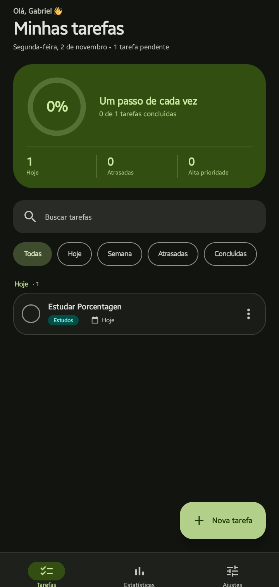

# Fluxo

Gerenciador de tarefas minimalista para Android com **Material You 3**, interface em português e dados 100% locais.



> **Baixe o APK na aba [Releases](../../releases).**

## ✨ Recursos

- **Tarefas organizadas** – Agrupadas em Atrasadas, Hoje, Amanhã, Esta semana, Mais tarde, Sem prazo e Concluídas
- **Prioridades e categorias** – Destaque tarefas importantes e organize por contexto
- **Prazo com horário** – Defina data e hora para seus compromissos
- **Lembretes com alarme** – Notificação com som de alarme e vibração no horário da tarefa, com ações para concluir ou adiar por 10 minutos
- **Tarefas recorrentes** – Diária, dias úteis, semanal, mensal ou dias personalizados (ex.: só às quartas-feiras), mantendo o horário
- **Personalização total de cores** – Cores dinâmicas do papel de parede (Android 12+), paletas prontas ou seletor livre para qualquer cor
- **Tema flexível** – Seguir sistema, claro ou escuro
- **Busca e filtros** – Encontre tarefas rapidamente
- **Estatísticas** – Acompanhe seu progresso dos últimos 7 dias
- **Ações rápidas** – Concluir/reabrir, editar, duplicar, excluir com desfazer
- **Privacidade** – Sem internet; tarefas, alarmes e notificações ficam apenas no aparelho

## 🔔 Lembretes

Ao definir um horário, o Fluxo agenda um alarme local e mostra uma notificação com som de alarme e vibração. Na notificação é possível **concluir** a tarefa ou **adiar por 10 minutos**.

- Android 13+: permita as notificações do app.
- Android 12+: para avisos pontuais, permita **Alarmes e lembretes** em *Ajustes → Lembretes → Alarmes exatos*.

Os alarmes são reagendados automaticamente ao reiniciar o aparelho ou mudar a data/fuso.

## 🛠️ Tecnologias

- Java 17
- Sem Gradle/AndroidX (toolchain manual com `aapt2`, `android.jar`, `D8/R8` e `apksigner`)
- Material You 3

## 🚀 Compilar

```bash
./build.sh
```

O APK será gerado em `Fluxo.apk`.

## 🤖 Desenvolvimento

**Este aplicativo foi desenvolvido com auxílio de Inteligência Artificial.**

## 📄 Licença

[MIT](LICENSE)
